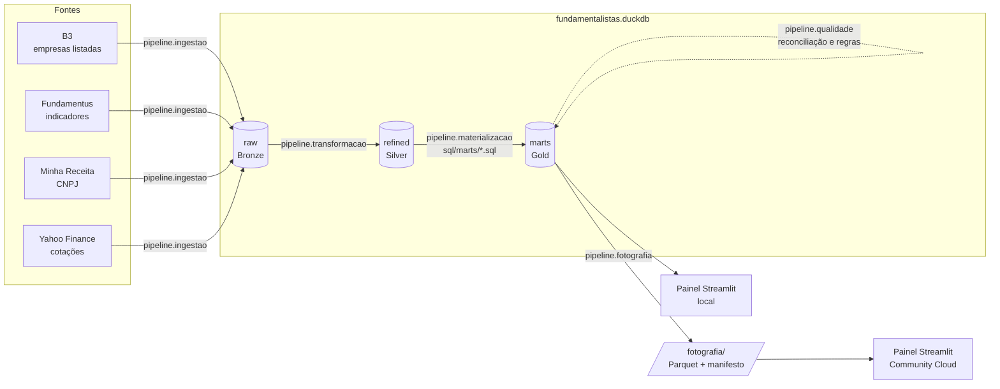
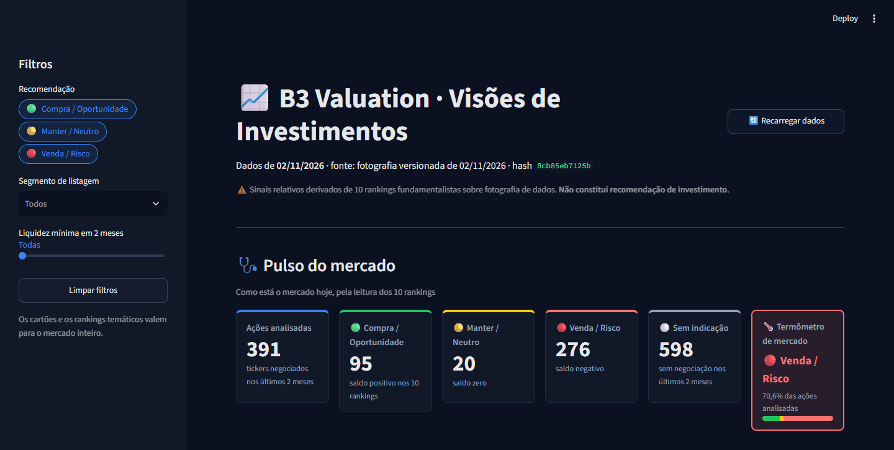
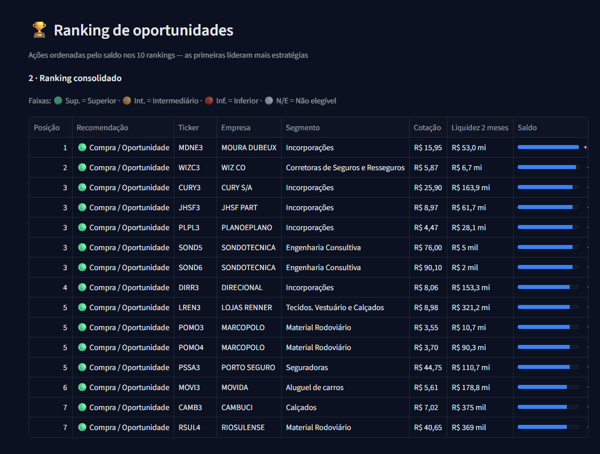
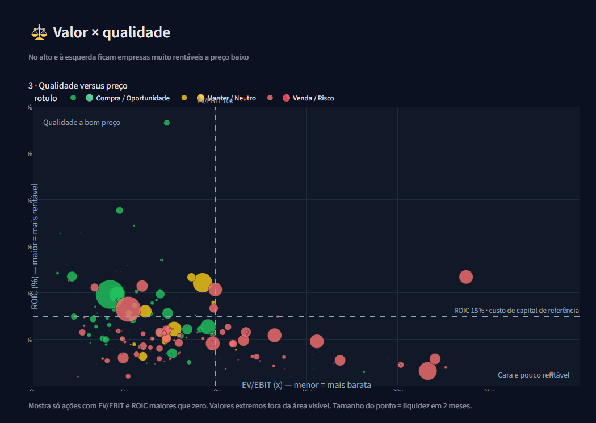
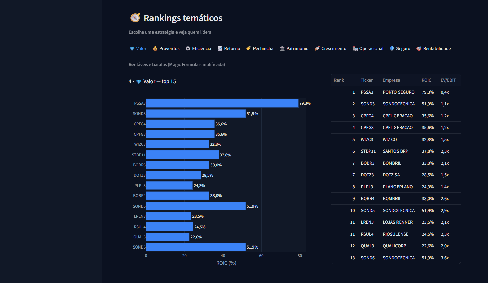
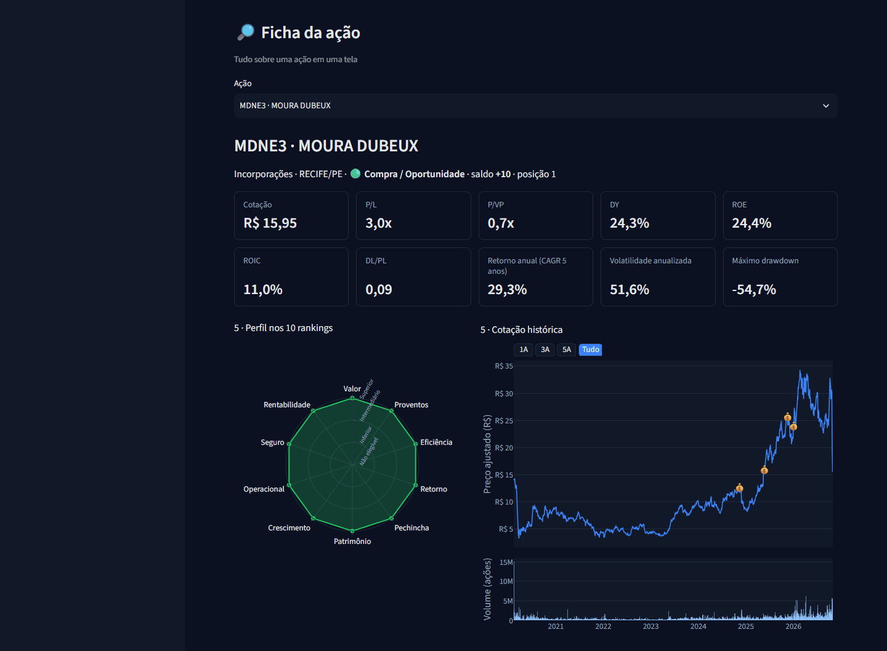

# B3 Valuation

[](https://valuationb3-zamonari.streamlit.app/)
[](https://github.com/rzamonari/valuation_b3/actions/workflows/ci.yml)

Pipeline de dados que consolida indicadores fundamentalistas das ações da B3 a partir de quatro
fontes públicas, calcula 10 rankings temáticos e uma recomendação consolidada por ação, e exibe
tudo num painel Streamlit somente leitura.

> Os sinais de Compra/Manter/Venda são **relativos e mecânicos**, derivados de 10 rankings sobre
> uma fotografia de dados. **Não constituem recomendação de investimento.**

## Acessos

| | |
|---|---|
| **Painel** | [valuationb3-zamonari.streamlit.app](https://valuationb3-zamonari.streamlit.app/) — Streamlit Community Cloud, sobre a fotografia versionada |
| **Documentação** | [docs/](docs/) — instalação e uso, arquitetura, decisões, specs e referência dos marts (`uv run mkdocs serve` para navegar localmente) |

## Objetivo

Responder, com regras explícitas e auditáveis, a uma pergunta de investidor iniciante: *entre as
ações negociadas hoje, quais aparecem bem posicionadas em vários critérios clássicos ao mesmo
tempo?* Cada critério (Valor, Proventos, Eficiência, Retorno, Pechincha, Patrimônio, Crescimento,
Operacional, Seguro e Rentabilidade) é um `SELECT` versionado em [sql/marts/](sql/marts/), e a
recomendação final é a soma das posições relativas em cada um
([regras](sql/marts/RANKINGS.md)).

## Arquitetura



| Camada | Schema | Módulo | Regra |
|---|---|---|---|
| Bronze | `raw` | [pipeline/ingestao.py](pipeline/ingestao.py) | Dado como veio, tudo `VARCHAR`, com carimbo de ingestão e origem |
| Silver | `refined` | [pipeline/transformacao/](pipeline/transformacao/) | Tipagem estrita, deduplicação e chaves validadas; sem cálculo |
| Gold | `marts` | [sql/marts/](sql/marts/) + [pipeline/materializacao.py](pipeline/materializacao.py) | Um `SELECT` por mart (30 marts); um mart lê outro (`marts.<nome>`) em vez de copiar a regra |
| Qualidade | — | [pipeline/qualidade.py](pipeline/qualidade.py) | 71 verificações: reconciliação raw → refined → marts e regras de domínio |
| Fotografia | `fotografia/` | [pipeline/fotografia.py](pipeline/fotografia.py) | Gold em Parquet + manifesto com data de referência e SHA-256 |
| Apresentação | — | [painel.py](painel.py) + [app.py](app.py) | Só lê, filtra e formata: número novo exige mart novo |

Cada etapa publica numa única transação (falha = `ROLLBACK`, versão anterior preservada), é
idempotente e termina com código `0` em sucesso e `1` em falha.

## Como executar

Requisitos: Python ≥ 3.13 e [uv](https://docs.astral.sh/uv/).

```powershell
uv sync

# pipeline completo (feche a DuckDB UI antes: um único processo grava no banco)
uv run python -m pipeline.ingestao        # 1. Bronze: extrai as 4 fontes (rede)
uv run python -m pipeline.transformacao   # 2. Silver
uv run python -m pipeline.materializacao  # 3. Gold: 30 marts
uv run python -m pipeline.qualidade       # 4. reconciliação e regras de domínio
uv run python -m pipeline.fotografia      # 5. fotografia versionada em fotografia/

uv run streamlit run app.py               # painel em http://localhost:8501
```

**Sem rodar o pipeline:** a fotografia versionada já está no repositório. Sem
`fundamentalistas.duckdb`, o painel lê `fotografia/` automaticamente, depois de conferir os
hashes do manifesto. `VALUATIONB3_FONTE=fotografia` força essa fonte mesmo com o banco presente.

```powershell
uv sync
uv run streamlit run app.py
```

Desenvolvimento (o mesmo roda no [GitHub Actions](.github/workflows/ci.yml) a cada push e PR):

```powershell
uv run ruff check .
uv run ruff format --check .
uv run pytest                                      # cobertura mínima de 85%
uv run python -m pipeline.fotografia --verificar   # integridade da fotografia
uv run mkdocs serve                                # documentação em http://127.0.0.1:8000
```

### Painel publicado no Streamlit Community Cloud

O [painel publicado](https://valuationb3-zamonari.streamlit.app/) roda a partir da branch `main`
(arquivo `app.py`, Python 3.13) e lê só a pasta `fotografia/`: o banco `fundamentalistas.duckdb`
não é versionado (passa do limite de 100 MB do GitHub) nem é necessário no Cloud. As dependências
vêm do `uv.lock` / [requirements.txt](requirements.txt), exportado dele
(`uv export --no-dev --no-hashes --no-emit-project --locked -o requirements.txt`); o CI falha se
os dois divergirem.

**Atualizar os dados publicados:** gerar → verificar → PR → merge com o CI verde → o Cloud faz
o redeploy.

```powershell
uv run python -m pipeline.ingestao        # dados novos das 4 fontes
uv run python -m pipeline.transformacao
uv run python -m pipeline.materializacao
uv run python -m pipeline.fotografia      # gerar: exige a qualidade sem erros
uv run python -m pipeline.fotografia --verificar   # verificar: hashes do manifesto
git switch -c data/fotografia-<data de referência>
git add fotografia/
git commit -m "data: fotografia de <data de referência>"
git push -u origin HEAD
gh pr create --fill                       # merge com o CI verde; o Cloud refaz o deploy
```

Depois do redeploy, o cabeçalho do painel mostra a nova data de referência e o início do novo
hash. Cada fotografia acrescenta cerca de 10 MB ao histórico do git (quase tudo `marts_cotacao`,
exportado só com as colunas que o painel usa).

## Painel

Capturas sobre a fotografia de 02/11/2026 (hash `8cb85eb7125b`). O
[painel publicado](https://valuationb3-zamonari.streamlit.app/) mostra a fotografia mais recente da
`main`.

**Pulso do mercado:** contagem por recomendação e termômetro. O cabeçalho mostra a fonte, a data
de referência e o hash da fotografia.



**Ranking de oportunidades:** ações ordenadas pelo saldo nos 10 rankings, com filtros por
recomendação, segmento e liquidez.



**Valor × qualidade:** ROIC contra EV/EBIT, com tamanho pela liquidez.



**Rankings temáticos:** as 15 primeiras de cada estratégia.



**Ficha da ação:** indicadores, retorno e risco em 5 anos, perfil nos 10 rankings e cotação histórica.



## Resultados

Fotografia de **02/11/2026**:

| | Quantidade |
|---|---:|
| Tickers no Fundamentus | 995 |
| Com emissora na B3 (universo dos rankings) | 541 |
| Ações analisadas (negociadas nos últimos 2 meses) | 391 |
| Compra / Manter / Venda | 95 / 20 / 276 |
| Sem indicação (sem negociação em 2 meses) | 598 |
| Cotações diárias (609 tickers, 2000 a 2026) | 1.920.774 |

O termômetro aponta **Venda / Risco** (70,6% das ações analisadas). Esse é um retrato relativo: a
maioria das ações fica fora do terço superior na maior parte dos critérios.

Tickers do Fundamentus fora do universo dos rankings (454), por motivo
(`marts_painel_exclusoes_motivo`). Em todos os casos, a emissora (4 primeiras letras) não está no
cadastro de empresas ativas da B3:

| Motivo | Regra | Tickers | Negociados em 2 meses |
|---|---|---:|---:|
| Fracionário | final F | 0 | 0 |
| BDR | final 32 a 35 | 9 | 0 |
| Unit | final 11 | 19 | 0 |
| Não identificado | negociado, mas sem emissora no cadastro | 6 | 6 |
| Deslistada ou cancelada | ON/PN sem negociação | 411 | 0 |
| Outro código | demais sufixos, sem negociação | 9 | 0 |

Elegíveis por ranking: Valor 387 · Proventos 256 · Eficiência 335 · Retorno 367 · Pechincha 336 ·
Patrimônio 384 · Crescimento 222 · Operacional 394 · Seguro 277 · Rentabilidade 397.

As 10 primeiras posições do ranking consolidado:

| Posição | Ticker | Empresa | Segmento | Saldo |
|---:|---|---|---|---:|
| 1 | MDNE3 | Moura Dubeux | Incorporações | +10 |
| 2 | WIZC3 | Wiz Co | Corretoras de Seguros e Resseguros | +9 |
| 3 | CURY3 | Cury | Incorporações | +8 |
| 3 | JHSF3 | JHSF Part | Incorporações | +8 |
| 3 | PLPL3 | Plano e Plano | Incorporações | +8 |
| 3 | SOND5 | Sondotécnica | Engenharia Consultiva | +8 |
| 3 | SOND6 | Sondotécnica | Engenharia Consultiva | +8 |
| 4 | DIRR3 | Direcional | Incorporações | +7 |
| 5 | LREN3 | Lojas Renner | Tecidos, Vestuário e Calçados | +7 |
| 5 | POMO3 | Marcopolo | Material Rodoviário | +7 |

**Qualidade dos dados** (`uv run python -m pipeline.qualidade`): 79 verificações, **0 erros** e
11 avisos. Todas as reconciliações raw → refined → marts batem, inclusive universo + exclusões =
995 tickers do Fundamentus, sem sobreposição. Os avisos são extremos reais da
fonte, preservados na Silver como vieram: ROE e margens fora de ±100%, 33 cotações zeradas no
Fundamentus (zero significa ausência), 18.350 fechamentos ajustados negativos no Yahoo Finance
(8 tickers) e 278 saltos no fechamento sem desdobramento nem provento (90 tickers). Nenhum
retorno ou risco é calculado a partir desses preços: os 6 tickers com um dos defeitos na janela
de 5 anos (PPAR3, AZUL3, FIGE3, MMAQ3, MMAQ4, PINE3) ficam sem cálculo, e a qualidade dá ERRO se
isso mudar.

**Testes:** 243 casos, cobertura de 93%, sem rede e sem tocar o banco real.

## Limitações

- Sinais relativos sobre uma única fotografia. Não consideram preço-alvo, valor intrínseco,
  governança, contexto setorial nem o perfil do investidor.
- O Rank Valor é uma versão simplificada da Magic Formula, e o payout é estimado (`DY × P/L`).
- Classes ON/PN da mesma emissora compartilham fundamentos e aparecem empatadas.
- Ficam fora dos rankings os tickers cuja emissora não está no cadastro de empresas ativas da B3
  (454 nesta fotografia; motivos na tabela de Resultados e no painel). Quase todos estão sem
  negociação há 2 meses. Os 6 negociados (ADHM3, BLUT3, BLUT4, IGBR3, RPMG3, SHOW3) não têm
  emissora com outro código no cadastro nem em `otherCodes`, e a qualidade avisa se passarem de
  10. Detalhes em [sql/marts/README.md](sql/marts/README.md) §13.
- O Yahoo Finance publica `fechamento_ajustado` negativo antes de proventos maiores que o
  fechamento anterior: o fator de ajuste `1 − provento / fechamento` fica negativo e inverte o
  sinal do passado. Os tickers com esse defeito na janela de 5 anos aparecem na ficha sem
  retorno e risco, com o motivo (`motivo_sem_calculo`, decisão D1 em
  [docs/specs/marts_sql_indicadores.md](docs/specs/marts_sql_indicadores.md)).
- O fechamento do Yahoo já vem ajustado por desdobramento. Por isso, uma razão diária acima de 5
  ou abaixo de 0,2 num pregão sem desdobramento nem provento indica grupamento não registrado ou
  cotação errada (decisão D2). Com um salto assim na janela de 5 anos, o ticker também fica sem
  retorno e risco (AZUL3, FIGE3, MMAQ3, MMAQ4 e PINE3 nesta fotografia). Um salto espalhado por
  vários pregões, cada um abaixo do limite, não é detectado.
- A fotografia ocupa cerca de 27 MB por versão no histórico do git. Se as atualizações ficarem
  frequentes, vale migrar `fotografia/` para Git LFS.

Mais detalhes: [documentação](docs/index.md) (`uv run mkdocs serve`), [referência da API](doc_api.md)
e [plano do projeto](plan.md).
